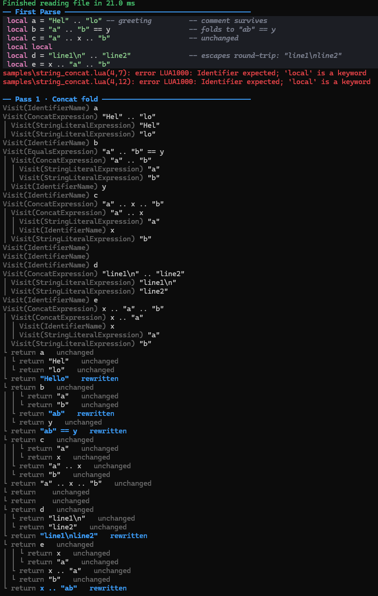

# Luminol Explore
This projected is intended to be an exploration of Loretta's functionality, as well as a starting point for the core of Luminol. Luminol is (to be) a Cybersecurity tool for deobfuscating GLua code.

It's ambitious in scope, but the general plan is to have it structured as such:
Luminol.Core -> Core Functionality
Luminol.CLI -> Implements Core into a CLI
Luminol.GUI -> Implements Core into a nice little GUI

## Current State
Right now, it's a fun little toy exploring Loretta, Console output, making pretty ANSI, etc.

Figure 1, pretty console output

## Planned Features
Step-by-step "debugger style" deobfuscation, the ability to view exactly what the visitors are doing, diffs of the code and the abstract syntax tree and its diffs between steps and as visitors are doing their thing. Being able to review the timeline, the changes, diffs on both the graph and code. Seeing the moving parts as they... move?

## Motivations
It's an ambitious project, but ultimately I intend to use it for my portfolio, as well as for my personal satisfaction. One of my clients challenged me a long time ago by sending me a heavily obfuscated file and implying I could never crack it. Well I suppose we will have to find out!

The file in question uses state of the art obfuscation, VM, bells and whistles included. So to be honest, we shall see how far I end up getting. The deobfuscator is intended to be obfuscator agnostic.

## Afterwards
I also am toying with the idea of trying to set up an AI pipeline afterwards to maintain it and keep it up to date with any new obfuscation techniques that surface onto the market. That is also a very ambitious project on it's own, and might end up needing a bit of crowd funding to be possible. Perhaps a "insert coin" to buy some tokens for the AI and have it look at your obfuscated code.

## Who am I?
My name is Michael, I'm a self-taught Senior Developer. I generally go where I'm needed, learning tools along the way. I'm sometimes asked what my strong points and weak points are, and to be honest after so many years it's difficult to give a concrete answer. If I had to pick a weakpoint, I'd say I don't love UI work. I like the artsy part of UI Design, but not the actual coding of UIs. Luckily AIs are quite good at that, which brings me to the next header.

## AI Use
Throughout making this, I decided to also use this project as a bit of a testing group to see how well I can integrate AI into my workflow. I'm primarily using Claude Opus 5.5@ Medium (Chat), and primarily using it to help me quickly learn what I need to in order to build this passion project. I intend to use Claude Code for some of the GUI work, but as a rule of thumb: There won't be a single line of code in this project that I do not personally understand.

I find learning to be a very fun game, and I would say I prefer playing games instead of watching others do it for me.